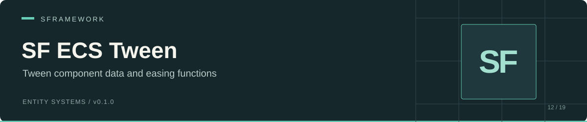

# SF ECS Tween

 

## Overview

Tween component data and interpolation math for SFramework's ECS integration. The package contains `MoveTo`, `RotateTo`, and `ColorTo` structs, curve helpers, and loop labels. Your project supplies the systems that advance and apply them.

## Requirements

The package ID is `sp.sframework.ecs.tween`, version `0.1.0`. [package.json](package.json) declares neither dependencies nor a minimum Unity version.

The [runtime asmdef](Runtime/SFramework.ECS.Runtime.Tween.asmdef) requires:

| Assembly | Supply through |
| --- | --- |
| `SFramework.Core.Runtime` | [SF Core](https://github.com/huran438/sf-core). |
| `SFramework.ECS.Runtime` | [SF ECS Odin](https://github.com/huran438/sf-ecs-odin), which includes the ECS runtime under `SFramework.ECS.Runtime`. |

Do not install both Lite SF integrations together; their assembly/type names overlap. [SF ECS Proto](https://github.com/huran438/sf-ecs-proto) does not satisfy the Lite runtime reference.

Install SF ECS Odin's dependencies as well, including SF Configs, SF Debug, UniTask, Newtonsoft.Json and Odin DLLs. External LeoECS Lite and Lite DI packages are not required. This package has no package-specific scripting define requirement.

## Installation

Use Unity Package Manager's **Add package from git URL** with:

```text
https://github.com/huran438/sf-ecs-tween.git#main
```

## Quick start

### Tween data

All three components implement `ISFComponent` and expose the same timing fields:

| Field | Type / role available to your runner |
| --- | --- |
| `Cooldown`, `Duration`, `ElapsedTime` | `float`; stored timing values. |
| `LoopType` | `TweenLoopType`: `None`, `Repeat`, `Continuous`, `YoYo`. |
| `AnimationCurve` | `TweenAnimationCurve`; selects a math function. |
| `UnscaledTime` | `bool`; lets your runner select a time source. |
| `StartValue`, `EndValue` | `Vector3` for `MoveTo` / `RotateTo`; `Color` for `ColorTo`. |

These fields do not update themselves. The repository provides no movement, rotation, color, cooldown, completion, or loop-processing system. Decide which transforms or renderers to affect and what each loop label means in your runner.

### Creating and evaluating a move

This example writes a `MoveTo` into an existing entity and evaluates its position. It uses `Replace` from SF ECS Odin. The example defines its own convention: `ElapsedTime` includes cooldown, then movement lasts `Duration` seconds.

```csharp
using System;
using SFramework.ECS.Runtime;
using SFramework.ECS.Runtime.Tween;
using UnityEngine;

public static class MoveTweenExample
{
    public static void Schedule(
        SFEcsWorld world, int entity,
        Vector3 start, Vector3 end, float duration)
    {
        if (!(duration > 0f) || float.IsInfinity(duration))
            throw new ArgumentOutOfRangeException(nameof(duration));

        ref var move = ref world.GetPool<MoveTo>().Replace(entity);
        move = new MoveTo
        {
            StartValue = start,
            EndValue = end,
            Cooldown = 0f,
            Duration = duration,
            ElapsedTime = 0f,
            UnscaledTime = false,
            LoopType = TweenLoopType.None,
            AnimationCurve = TweenAnimationCurve.EaseInOut
        };
    }

    public static Vector3 Step(ref MoveTo move)
    {
        move.ElapsedTime += move.UnscaledTime
            ? Time.unscaledDeltaTime
            : Time.deltaTime;

        if (move.ElapsedTime < move.Cooldown)
            return move.StartValue;

        var t = move.Duration > 0f
            ? Mathf.Clamp01((move.ElapsedTime - move.Cooldown) / move.Duration)
            : 1f;

        return SFMathFXHelper.CurvedValueECS(
            move.AnimationCurve, move.StartValue, move.EndValue, t);
    }
}
```

Call `Schedule` for a live entity. Your update system can call `Step(ref move)`, apply the returned position, and remove or reset the tween once `ElapsedTime >= Cooldown + Duration`. The sample holds the start position during cooldown and uses the chosen curve's value at progress 1 when time expires. `Step` handles a single pass. Add your own loop policy before using other `LoopType` values.

For color interpolation, `SFMathFXHelper.CurvedValueECS(curve, startColor, endColor, t)` evaluates red, green, blue, and alpha. For rotation, `RotateTo` stores vector endpoints; your runner chooses the rotation representation and applies it.

## API

| `TweenAnimationCurve` | Helper implementation |
| --- | --- |
| `EaseInOut` | `SFMathFX.Hermite`. |
| `EaseOut` | `SFMathFX.Sinerp`. |
| `EaseIn` | `SFMathFX.Coserp`. |
| `Berp` | Oscillating interpolation with overshoot. |
| `Bounce` | `start + (end - start) * SFMathFX.Bounce(t)`. |
| `Lerp` | Linear interpolation without clamping in `SFMathFX.Lerp`. |
| `Clerp` | `SFMathFX.CLerp`, which handles the 0–360 wraparound for scalar values. |

[`SFMathFXHelper`](Runtime/SFMathFXHelper.cs) exposes `CurvedValue` for `float`, `Vector2`, and `Vector3`, plus `CurvedValueECS` for those types and `Color`. Both entry points use the same scalar curve dispatch.

[`SFMathFX`](Runtime/SFMathFX.cs) also provides `SmoothStep`, `NearestPoint`, `NearestPointStrict`, and `Approx`. `NearestPoint` projects onto an infinite line; `NearestPointStrict` clamps to the segment. `Approx` accepts a tolerance for scalar or `Vector3` values.

## Behavior and limitations

- Supply a normalized progress value and validate durations in your runner. The helpers do not provide a shared clamping or duration policy.
- `Bounce(1)` is zero, so the corresponding interpolation returns the start value at `t = 1`. Use it as a decaying offset or choose a curve that ends at the target for a one-way transition.
- `Clerp` handles scalar degree wraparound. Vector/color helper overloads apply it per component; it does not perform quaternion interpolation.
- With equal bounds, `SmoothStep` returns zero below the bound and one at or above it.
- An unknown curve value returns zero for each interpolated component.
- The structs do not have `[SFGenerateComponent]`. This package supplies no generated Unity authoring providers or tween systems.

## Tests

Package tests are in [Tests/Editor](Tests/Editor) and use the `SFramework.ECS.Tween.Editor.Tests` assembly. Install Unity Test Framework (`com.unity.test-framework`) in the host project. Test assemblies are Editor-only and gated by `UNITY_INCLUDE_TESTS`.

Add `sp.sframework.ecs.tween` to the top-level `testables` array in the host project's `Packages/manifest.json`, preserving its dependencies and any existing testable entries:

```json
{
  "testables": ["sp.sframework.ecs.tween"]
}
```

Open **Window > General > Test Runner**, select **EditMode**, and run `SFramework.ECS.Tween.Editor.Tests`. The `sf-demo` host enables all SFramework package tests in its manifest.

The EditMode suite covers interpolation math. It does not provide or validate a gameplay tween runner, timing policy, loop-processing system, or player-platform behavior. The host must satisfy the selected Lite integration's dependencies.

## License

MIT. See [LICENSE.md](LICENSE.md). Dependencies retain their own licensing terms.
