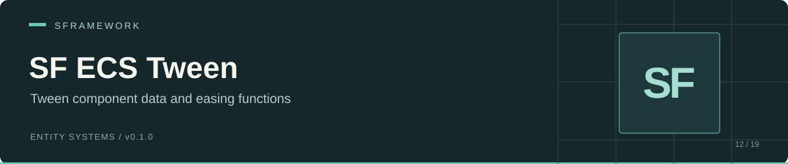

# SF ECS Tween

[Documentation website](https://docs.secretplace.studio/#sf-ecs-tween)

Tween component data and interpolation math for SFramework's **LeoECS Lite** integration. The package contains `MoveTo`, `RotateTo`, and `ColorTo` structs, curve helpers, and loop labels. Your project supplies the systems that advance and apply them.

 

[Install](#installation) · [Data](#tween-data) · [Example](#creating-and-evaluating-a-move) · [Math](#curve-and-math-api) · [Limits](#known-limits)

## Installation

Use Unity Package Manager's **Add package from git URL** with:

```text
https://github.com/huran438/sf-ecs-tween.git#main
```

The package ID is `sp.sframework.ecs.tween`, version `0.1.0`. [package.json](package.json) declares neither dependencies nor a minimum Unity version.

The [runtime asmdef](Runtime/SFramework.ECS.Runtime.Tween.asmdef) requires:

| Assembly | Supply through |
| --- | --- |
| `SFramework.Core.Runtime` | [SF Core](https://github.com/huran438/sf-core). |
| `SFramework.ECS.Runtime` | One Lite integration: [SF ECS](https://github.com/huran438/sf-ecs) or [SF ECS Odin](https://github.com/huran438/sf-ecs-odin). Check that variant's dependency requirements and limits. |
| `Leopotam.EcsLite` | A compatible LeoECS Lite installation. |

Do not install both Lite SF integrations together; their assembly/type names overlap. [SF ECS Proto](https://github.com/huran438/sf-ecs-proto) does not satisfy the Lite runtime reference.

## Tween data

All three components implement `ISFComponent` and expose the same timing fields:

| Field | Type / role available to your runner |
| --- | --- |
| `Cooldown`, `Duration`, `ElapsedTime` | `float`; stored timing values. |
| `LoopType` | `TweenLoopType`: `None`, `Repeat`, `Continuous`, `YoYo`. |
| `AnimationCurve` | `TweenAnimationCurve`; selects a math function. |
| `UnscaledTime` | `bool`; lets your runner select a time source. |
| `StartValue`, `EndValue` | `Vector3` for `MoveTo` / `RotateTo`; `Color` for `ColorTo`. |

These fields do not update themselves. The repository provides no movement, rotation, color, cooldown, completion, or loop-processing system. Decide which transforms or renderers to affect and what each loop label means in your runner.

## Creating and evaluating a move

This example writes a `MoveTo` into an existing Lite entity and evaluates its position. It uses `Replace` from your chosen SF Lite integration. The example defines its own convention: `ElapsedTime` includes cooldown, then movement lasts `Duration` seconds.

```csharp
using System;
using Leopotam.EcsLite;
using SFramework.ECS.Runtime;
using SFramework.ECS.Runtime.Tween;
using UnityEngine;

public static class MoveTweenExample
{
    public static void Schedule(
        EcsWorld world, int entity,
        Vector3 start, Vector3 end, float duration)
    {
        if (duration <= 0f)
            throw new ArgumentOutOfRangeException(nameof(duration));

        ref var move = ref world.GetPool<MoveTo>().Replace(entity);
        move = new MoveTo
        {
            StartValue = start,
            EndValue = end,
            Cooldown = 0f,
            Duration = duration,
            ElapsedTime = 0f,
            UnscaledTime = false,
            LoopType = TweenLoopType.None,
            AnimationCurve = TweenAnimationCurve.EaseInOut
        };
    }

    public static Vector3 Step(ref MoveTo move)
    {
        move.ElapsedTime += move.UnscaledTime
            ? Time.unscaledDeltaTime
            : Time.deltaTime;

        var t = move.Duration > 0f
            ? Mathf.Clamp01((move.ElapsedTime - move.Cooldown) / move.Duration)
            : 1f;

        return SFMathFXHelper.CurvedValueECS(
            move.AnimationCurve, move.StartValue, move.EndValue, t);
    }
}
```

Call `Schedule` for a live entity. Your update system can call `Step(ref move)`, assign the returned position to its target, and remove or reset the tween after completion. `Step` handles a single pass; add your own loop policy before using other `LoopType` values.

For color interpolation, `SFMathFXHelper.CurvedValueECS(curve, startColor, endColor, t)` evaluates red, green, blue, and alpha. For rotation, `RotateTo` stores vector endpoints; your runner chooses the rotation representation and applies it.

## Curve and math API

| `TweenAnimationCurve` | Helper implementation |
| --- | --- |
| `EaseInOut` | `SFMathFX.Hermite`. |
| `EaseOut` | `SFMathFX.Sinerp`. |
| `EaseIn` | `SFMathFX.Coserp`. |
| `Berp` | Oscillating interpolation with overshoot. |
| `Bounce` | `start + (end - start) * SFMathFX.Bounce(t)`. |
| `Lerp` | Linear interpolation without clamping in `SFMathFX.Lerp`. |
| `Clerp` | `SFMathFX.CLerp`, which handles the 0–360 wraparound for scalar values. |

[`SFMathFXHelper`](Runtime/SFMathFXHelper.cs) exposes `CurvedValue` for `float`, `Vector2`, and `Vector3`, plus `CurvedValueECS` for those types and `Color`. The scalar switches use the same curve implementations; the ECS name does not add scheduling behavior.

[`SFMathFX`](Runtime/SFMathFX.cs) also provides `SmoothStep`, `NearestPoint`, `NearestPointStrict`, and `Approx`. `NearestPoint` projects onto an infinite line; `NearestPointStrict` clamps to the segment. `Approx` accepts a tolerance for scalar or `Vector3` values.

## Known limits

- Supply a normalized progress value and validate durations in your runner. The helpers do not provide a shared clamping or duration policy.
- `Bounce(1)` is zero, so the corresponding interpolation returns the start value at `t = 1`. Use it as a decaying offset or choose a curve that ends at the target for a one-way transition.
- `Clerp` handles scalar degree wraparound. Vector/color helper overloads apply it per component; it does not perform quaternion interpolation.
- `SmoothStep` divides by `max - min`; use distinct bounds.
- An enum value outside the declared curve values returns zero from the scalar switch.
- The structs do not have `[SFGenerateComponent]`. This package supplies no generated Unity authoring providers or tween systems.

## Validation and license

This README describes source at commit [`a9e093d`](https://github.com/huran438/sf-ecs-tween/commit/a9e093dc06868743a14546192cfecfb8493f28ca). The examples received static source review only. No Unity compilation, Play Mode, player build, or automated test execution accompanied this documentation. The package declares no minimum Unity version.

This repository uses the [MIT license](LICENSE.md). Check the licenses and integration requirements of your selected [SF ECS](https://github.com/huran438/sf-ecs) or [SF ECS Odin](https://github.com/huran438/sf-ecs-odin) dependency.
